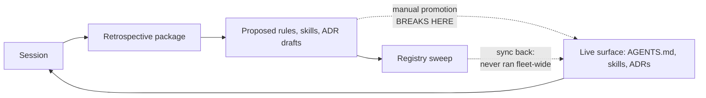

# Common Operating Environment (COE)

**Source:** `ai-utils/coe/README.md`, `ai-utils/coe/survey-2026-07-02.md`, `ai-utils/coe/survey-2026-07-02-repo-profiles.md`

---

A proposed standard for repositories that are developed with an AI partner
(Claude Code or similar). Captured from handwritten notes dated 2026-07-01;
expanded with interpretation, suggestions, and a proposed roadmap.

## Guiding approach: incremental and empirical

The most important constraint on this whole effort: **what the standard
looks like at the end will almost certainly not match what it looks like in
anyone's head at the start.** So the process is iterate/try, not
specify/build:

- **Grow the standard from real projects, not from theory.** The first
  input is a survey of current, working repositories — where instructions
  actually live today, what friction actually occurs — and the standard
  starts as the smallest thing that fixes observed friction.
- **Every version is an experiment.** A COE version is a hypothesis
  ("repos are easier for an AI partner if X"); adoption on a real repo is
  the test; friction reports are the results. Versions should be small and
  cheap to abandon.
- **The standard follows practice, never leads it.** Nothing enters the
  spec until it has been tried by hand on at least one real repo and kept
  because it earned its place. The spec documents what already works; it
  does not prescribe what might.
- **Expect churn early; design for it.** Because early versions will be
  wrong, the upgrade/migration path (see "adoption first-class" below)
  matters from v0.1 — it is what makes changing course cheap instead of
  painful.

## Original notes (transcribed)

- Common operating environment (COE)
  - Skills
  - AGENTS.md
  - Sandbox
    - APIs available / keys
    - Network permissions
    - Data access
    - Cloud env.
  - Principles
    - Adoption + upgrades to COE 1st class
    - Progressive disclosure (enforced)
    - Shared mutable knowledge base
    - Retrospection / self-optimization
  - Directory structure
  - Deterministic checks
    - Hooks (specifically for Claude Code)
    - Linters
    - GH actions
  - Devcontainer(s)

## Summary / interpretation

The COE is a **repository conformance standard**: any repo that adopts it
gives an AI partner a predictable environment — the agent always knows where
instructions live, what it is allowed to touch, what checks will run, and how
to record what it learned. The notes break down into three layers:

1. **Contract with the agent** — `AGENTS.md`, skills, directory structure,
   progressive disclosure. What the agent reads and when.
2. **Execution environment** — sandbox manifest (APIs/keys, network, data
   access, cloud), devcontainer(s). What the agent runs in.
3. **Feedback loops** — deterministic checks (hooks, linters, GH Actions),
   shared knowledge base, retrospection/self-optimization. How quality is
   enforced and how the system improves itself.

Plus a meta-principle that ties it together: **adoption and upgrades are
first-class**. Installing the COE into a repo, and moving a repo from COE
vN to vN+1, must be a supported, largely automated operation — not a
copy-paste exercise.

## Suggested shape of the standard

These are candidate mechanisms, not commitments — each one enters the
standard only after surviving the iteration loop below. Treat the COE like
a versioned spec with a reference implementation:

- **A spec document** (`SPEC.md`) using MUST / SHOULD / MAY language,
  versioned (v0.1, v0.2, ...). Small enough to read in one sitting.
- **A machine-readable manifest** in each conforming repo (e.g. `coe.yaml`)
  declaring: COE version, sandbox requirements (named API keys — names only,
  never values), network allowlist, data-access scope, and cloud environment
  assumptions. This is the file both humans and conformance tooling read.
- **A template / reference implementation** — a directory in this repo (or a
  template repo) containing the canonical `AGENTS.md` skeleton, `.claude/`
  layout (skills, hooks, settings), devcontainer, linter configs, and GH
  Actions workflows.
- **An installer + upgrader** — a slash command or small CLI (`/coe-init`,
  `/coe-upgrade`) that stamps the standard into a repo and migrates between
  versions. This directly extends the existing idea in `ideas.md` about
  slash commands that set up agents/skills/prompts from this repository.
- **A conformance checker** — a GH Action (and matching local script) that
  validates a repo against its declared COE version: required files present,
  AGENTS.md within size budget, hooks configured, manifest schema valid.

### Notes per component

- **AGENTS.md** — keep it short and enforce it (progressive disclosure):
  a size budget checked by the linter, with pointers to deeper docs and
  skills rather than inlined detail. Consider a tool-agnostic core
  (`AGENTS.md` is emerging as a cross-tool convention) with a thin
  Claude-Code-specific adapter (`CLAUDE.md` importing it) so the standard
  is not locked to one vendor.
- **Skills** — canonical skills live here in ai-utils and are *installed*
  into repos by the installer, so fixes propagate on upgrade instead of
  drifting per-repo.
- **Sandbox** — the manifest declares needs; the devcontainer and Claude
  Code permission settings *implement* them. One source of truth, generated
  outputs.
- **Deterministic checks** — the same checks should run in three places
  with one config: Claude Code hooks (immediate feedback while the agent
  works), pre-commit/local scripts, and GH Actions (authoritative). Hooks
  and CI drifting apart is the main failure mode to design against.
- **Shared mutable knowledge base** — decide early where it lives: a
  `knowledge/` directory per repo, synced or referenced from a central hub
  (this repo is the natural hub). Define who may write (agent
  retrospection sessions append; periodic distillation compacts).
- **Retrospection / self-optimization** — an end-of-session skill that
  appends learnings to the knowledge base, plus a periodic "distill and
  propose COE changes" task. This is what makes the standard improve
  instead of rot.

## Roadmap as an iteration loop

Not a waterfall — each numbered item is one turn of a
try → observe → adjust loop, and any of them can send the plan back a step.

0. **Survey current projects** — DONE 2026-07-02. Walk several existing,
   in-flight repositories and record: where AI instructions live now, what
   is duplicated between repos, what the agent repeatedly gets wrong or has
   to rediscover, which checks exist and where they drift. The output is a
   friction list, ranked. This grounds everything after it in "where I am
   now" rather than "where I imagine I want to be."
   → Results: [survey-2026-07-02.md](#appendix-a-coe-survey--eight-repos-2026-07-02) (ranked
   friction list, keepers, suggested v0.1 scope) and
   [survey-2026-07-02-repo-profiles.md](#appendix-b-coe-survey--per-repo-profiles-2026-07-02)
   (per-repo evidence).
1. **v0.1 spec** — write `SPEC.md` covering only the two or three
   highest-friction items from the survey (likely AGENTS.md conventions +
   directory structure + deterministic checks). Leave
   sandbox/knowledge-base as "reserved" sections. Explicitly mark v0.x as
   unstable: anything can change based on usage.
2. **Dogfood** — apply v0.1 by hand to ai-utils and one or two of the
   surveyed repos. Keep a running log of what was annoying, ignored, or
   wrong; that log is the v0.2 backlog.
3. **Reference template** — extract what dogfooding actually produced
   (not what the spec said) into a template directory.
4. **Installer** — `/coe-init` slash command that applies the template to a
   fresh repo; then `/coe-upgrade` with a version stamp (`coe.yaml`). Only
   automate once the manual process has stabilized enough to be worth
   automating.
5. **Conformance CI** — GH Action validating the manifest and required
   structure; warnings first, failures only once a rule has survived a few
   iterations without being changed.
6. **Rounds 2+** — sandbox manifest → devcontainer generation, knowledge
   base, retrospection skill. Each lands as a spec version bump plus an
   upgrader migration, and each goes through the same
   try-by-hand-first loop.

## Open questions

- **Scope**: per-repo standard only, or also an org-level layer (shared
  settings, shared knowledge hub)?
- **Vendor coupling**: how much is Claude-Code-specific (hooks, `.claude/`)
  vs. tool-agnostic (AGENTS.md, devcontainer, CI)? Suggest: agnostic core,
  vendor adapters.
- **Secrets**: manifest names required keys, but what provisions them —
  devcontainer secrets, environment config, something else?
- **Knowledge base writes**: does the agent commit learnings directly, or
  propose them via PR for human review?
- **Enforcement strictness**: is non-conformance a CI failure or a warning?
  Likely warning at first, failure once the standard stabilizes.

---

## Appendix A: COE survey — eight repos, 2026-07-02

**What this is.** Roadmap step 0 from [README.md](#common-operating-environment-coe): a survey of the
eight active AI-partnered repos, a ranked friction list, the conventions that
earned their place, and a suggested scope for COE v0.1. Per-repo detail lives
in [survey-2026-07-02-repo-profiles.md](#appendix-b-coe-survey--per-repo-profiles-2026-07-02);
this file is the synthesis.

**Repos surveyed:** agent-os, ai-skills, ai-utils, conference-summaries,
k8s-platform, policy-engine, software-factory, software-factory-prototype.

---

### The headline finding

You don't need to invent a standard — a de-facto one already exists across
these repos (pointer-style CLAUDE.md → AGENTS.md, dated retrospective
packages, numbered ADRs, skills with a fixed shape). What's missing is not
convention; it's **distribution and enforcement**. Two facts from the survey
dominate everything else:

1. **Every convention held by a mechanical check held; every convention held
   by prose or memory drifted.** This is not just k8s-platform's forensic
   conclusion ("bug classes covered by a blocking hook or fail-closed gate
   show zero recurrence; behaviors covered only by prose recurred for the
   life of the project") — the survey reproduced it *structurally* across all
   eight repos. Unchecked: stale self-descriptions, stranded rule proposals,
   diverged skill copies, root sprawl. Checked (k8s-platform's root
   allowlist, ADR-numbering, version-pin lints; ai-skills' canonical-JSON
   idempotence): held.

2. **The fleet's two most developed repos embody contradictory conclusions
   about the same mechanism.** ai-skills is built around assembling AGENTS.md
   from swept per-rule fragments. k8s-platform ran that exact pipeline for
   six weeks, measured it (152 rule candidates → 51 adopted → the top failure
   modes recurred anyway), and retired it in favor of "write the check, not
   the rule." COE v0.1 has to pick a side — see the decision point below.

Everything else in this survey is detail supporting those two facts.

### The eight repos at a glance

| Repo | What it is | Entry chain (lines) | Skills | CI / hooks | Retros |
|---|---|---|---|---|---|
| software-factory | dark-factory research + architecture corpus | CLAUDE (5) → AGENTS (206) → AGENT-ENTRY (150) | 24 | 5 workflows, 2 hooks | 57 |
| k8s-platform | ephemeral EKS demo platform (terraform/crossplane/argocd) | CLAUDE (8) → AGENTS (142, budget ≤150) → ai/LESSONS.md | 11 (+10 archived) | 10 workflows, ~90 lints, 3 hooks | 50 |
| agent-os | architecture-of-record for an agent runtime | AGENTS (53) only | 11 | none | 4 |
| ai-skills | cross-repo registry for skills/rules/ADRs | README → AGENTS (73, generated) | 2 (+19 registry copies) | 5 workflows | 3 |
| policy-engine | policy-platform spec/plan corpus (prose only) | none — INDEX.md (297) | 6 | none | 2 |
| conference-summaries | conference-data extraction (pre-implementation) | CLAUDE (4, tombstone) → AGENTS (82) | 6 | none | 0 |
| sf-prototype | dockerized Gas City deployment (running code) | CLAUDE (12) → AGENTS (61) → docs/HANDOFF §3 | 0 | 1 hook, local `make test` | 0 |
| ai-utils | seed ideas + this COE effort | README (3) | 0 | none | 0 |

Reading the table columns against each other: the three repos with *any*
mechanical enforcement (k8s-platform, software-factory, ai-skills) are also
the three whose conventions are most intact. The five with none run entirely
on convention — and every one of them shows the drift symptoms below.

### Where the same thing lives under eight different names

Each row is one document class every repo needs. The variant count is the
finding: an agent (or you) re-learns these locations on every repo switch.

| Document class | Variants found |
|---|---|
| Agent entry point | `AGENTS.md` alone · `CLAUDE.md`→`AGENTS.md` pointer (4 wordings) · `INDEX.md` with no AGENTS.md · bare README |
| Deep-dive navigation | `AGENT-ENTRY.md` (software-factory) · header-gated `ai-guidance/` (conference-summaries) · `INDEX.md` per-doc "when to consult" (policy-engine) · none |
| Session handoff | `ai/handoff.md` (91 KB) · `_meta/HANDOFF.md` (3 sessions stacked) · `spec-plan/HANDOFF.md` · `docs/HANDOFF.md` · 13 × `SESSION-HANDOFF-*.md` |
| Decisions (ADRs) | `adr/NNNN-*.md` · `docs/adr/NNNN-*.md` · `docs/decisions/NNNN-*.md` · `adrs/<kebab>.md` (no numbers) · retro Part-4 titles never authored |
| Decisions (other) | root `decisions/` (scope envelopes, not ADRs) · `DECISIONS.md` · `decision-journal.md` · `_meta/reviews/` (4 overlapping files) |
| Retrospectives | `retrospective/YYYY-MM-DD-PPP.md` + sibling dir — **the one convention 6 of 8 repos share** (3 generations of internal format) |
| Environment facts | `ai/environment.md` (k8s-platform only) · scattered in AGENTS.md/HANDOFF elsewhere |
| Scratch / temp | `temp/` gitignored (with one tracked file anyway) · nothing declared elsewhere |
| Session residue | 15 grandfathered root files (k8s-platform) · root `overnight-summary.md` + `PR-N-` archive prefix (software-factory) · none |

### Ranked friction list

Ranked by cost: how much re-learning, re-derivation, or silent wrongness each
one produces per session, times how many repos it touches.

#### 1. The learning loop is broken at the promotion step, fleet-wide

Every repo runs the same loop: session → retrospective → proposed rules /
skills / ADR drafts → *promotion into the live instruction surface*. The last
leg is manual everywhere, and it has failed everywhere, in escalating ways:

- **policy-engine:** two retros proposed 18 rules addressed to "AGENTS.md at
  the repo root" — *the repo has no AGENTS.md*. Sessions re-derive the same
  rules ("write the master index before fan-out" was proposed twice, a month
  apart) because there's no merged file to check against.
- **agent-os:** ~28 rules proposed across 4 retros; 6 promoted. Three
  proposed skills were never built and sit indistinguishable from the ones
  that were.
- **software-factory:** 181 per-rule artifacts produced; ~30 adopted. No
  visible tracking of live vs. pending.
- **ai-skills (the registry itself):** its generated AGENTS.md renders 13 of
  51 live rules — the flagship regeneration was never re-run after the big
  sweep. Three rules were hand-landed bypassing its own pipeline.
- **k8s-platform:** promoted aggressively (51 rules), measured the result —
  target behaviors didn't change — and concluded the channel itself was the
  problem.

Why it ranks first: the retros are consistently excellent (k8s-platform's
forensics called retrospective honesty "the project's single best asset"),
so the fleet pays full price for harvesting knowledge and then loses most of
it in transit.

#### 2. Skill distribution is copy-paste, so drift is structural

The same skills are installed in up to five repos by hand-copying, and the
registry designed to fix this doesn't cover the fleet:

- `self-retrospective` exists in **three generations simultaneously**: 530
  lines (conference-summaries, policy-engine), 1355 lines (agent-os,
  software-factory, and the registry copy), 1401 lines (k8s-platform — which
  amended it on evidence to stop emitting per-rule files). The amendment
  never propagated; two repos still run the process a third repo proved out
  and retired, and the registry serves the pre-amendment version.
- The registry sweep config tracks **2 of 8 repos** (itself and
  software-factory). Distribution to the others has been manual ("copy
  factory skills" PRs, "from software-factory" commits).
- The registry's folded-in copy of *its own tooling* has diverged from its
  live copy — a subscriber would receive an outdated skill-registry.
- conference-summaries' imported skills still cite another repo's branches
  and assume a `retrospective/` dir and CI that don't exist there.

The design is sound (content-addressed ledgers, semantic-diff review,
hard-stop invariants). What's missing is coverage and a drift gate — the
registry currently relies on a human remembering to run sweep and sync.

#### 3. Where there is no check, the artifact lies

Recurring shape: a file that *describes* state drifts from the state, and
nothing notices. This is what makes agents confidently wrong at session start.

- software-factory's failure-modes CI gate watches `architectures/0N-*.md`
  and `architectures/failure-modes.md` — **neither exists anymore**. The gate
  has been green and dormant since the corpus moved to a different naming
  scheme.
- ai-skills: 3 of 4 ledger renders stale (skills ledger shows 5 of 21
  entries); generated AGENTS.md stale by ~41 rules.
- conference-summaries: AGENTS.md's own "repository structure" block omits 4
  of the directories that exist, and two progress docs point at files that
  moved or never existed.
- policy-engine: four documents self-report the corpus size four different
  ways; a superseded schema spec is still in place next to its replacement.
- software-factory: `CONTEXT-SLIMMING-PLAN.md` still says "Plan, not
  implemented" — it was implemented (`AGENT-ENTRY.md` exists and follows it).
- k8s-platform's counterexamples prove the mechanism: root allowlist, ADR
  numbering, account-ID, version-pin-pairing lints — the covered classes
  stopped recurring.

#### 4. Eight repos, six entry contracts

An agent landing in a repo must discover *how to orient* before it can
orient. The chains range from excellent to absent: software-factory's
three-file chain with task-aware reading lists; k8s-platform's budgeted
operating agreement; conference-summaries' tombstone CLAUDE.md;
policy-engine's no-README, no-AGENTS.md, three competing indexes; ai-utils'
three-line README. The CLAUDE.md→AGENTS.md pointer alone has four wordings.
None of this is checked, so even the good chains rot (see friction 3).

#### 5. One document class, many homes (and root-level residue)

The variants table above is the evidence. Two aggravations:

- **Root sprawl as session residue:** 15 grandfathered run-summaries and
  envelopes at k8s-platform's root (its own forensics: "16 ephemeral session
  artifacts… contradictory belief states" — now linted, not yet relocated);
  software-factory's root mixes the live overnight-summary with three
  overlapping forward-looking docs.
- **"Decisions" means three different things** at k8s-platform alone (ADRs
  in `docs/decisions/`, autonomous-run envelopes in root `decisions/`, and
  skills that reference a `docs/adr/` that doesn't exist there).

#### 6. Handoffs and instruction files grow without bound

No document class has a size or rotation rule outside k8s-platform's AGENTS
budget. Observed: `ai/handoff.md` at 91 KB and `docs/open-issues.md` at 90 KB
(k8s-platform); three sessions stacked in one HANDOFF (agent-os); 13
sequential SESSION-HANDOFF files with the active one tracked only in prose
(software-factory); a 1355-line skill whose per-session description load the
k8s-platform forensics explicitly costed (15.2K tokens minimum per session
before its restructure, target ≤8K after). Instruction surface is a real
per-session cost and only one repo budgets it.

#### 7. Environment facts are rediscovered per session

Only k8s-platform has a declared capability-facts file (`ai/environment.md`,
born from forensics: "capability gaps spawn workaround layers; document the
capability profile in ONE place"). software-factory-prototype's equivalent —
the sandbox build recipe — is deliberately *uncommitted* prose re-created
from HANDOFF §3 each session. The COE notes' "sandbox manifest" idea is
exactly this gap; nothing implements it yet.

#### 8. Small hygiene frictions that break tooling

Individually minor, all instantly lintable: filenames with spaces (5 root
docs in policy-engine — they broke this survey's own shell globs); versions
baked into filenames (`spec v1.md`, `C2-v1.0-rc-RECONCILED.md` — the corpus
documents the "is C2 frozen?" confusion this caused); stock 219-line Python
.gitignore in two repos with zero Python; a hardcoded Windows path in
committed config; a tracked file inside a gitignored `temp/`.

### What earned its place

Conventions that survived contact with real work, with the repo that proved
them. These are the raw material for the v0.1 template — already tried, per
the "standard follows practice" rule in the COE README.

| Theme | Convention (provenance) |
|---|---|
| Entry | CLAUDE.md as a ≤10-line pointer to AGENTS.md; single source of truth (4 repos). Prototype's twist: the pointer also carries the one most load-bearing environment fact inline. |
| Entry | AGENTS.md as a **budgeted operating agreement** — ≤150 lines, judgment rules only, "mechanical rules are enforced, not memorized" (k8s-platform). |
| Entry | Progressive disclosure for big corpora: an entry doc that *names* what each sub-doc contains, never restates conclusions, plus task-aware reading lists (software-factory); header-gated "WHEN TO READ THIS" blocks on deep docs (conference-summaries); per-doc "when to consult" index entries (policy-engine). |
| Memory | Retrospective package: `retrospective/YYYY-MM-DD-PPP.md` + sibling artifact dir with durable hash-ID filenames (6 repos; software-factory/k8s-platform most mature). |
| Memory | The remedy-decision protocol: classify every lesson as *mechanical check > one budgeted AGENTS.md line > structural proposal > observation only* (k8s-platform — the empirically-backed doctrine). |
| Memory | ADRs: `NNNN-kebab-title.md`, fixed Context→Decision→Alternatives→Consequences→References order, relative links (agent-os is the reference implementation; 74 in software-factory). |
| Memory | Session handoff as a fixed-skeleton pickup brief: what's true now / how to build here / next action (prototype's `docs/HANDOFF.md` is the cleanest; k8s-platform's "facts + next action only" rule keeps it honest). |
| Enforcement | Root-file allowlist lint; audit-before-enforce (new checks scan every existing path and land green in the same PR); verify-then-PR mirror gates for heavy dispatch-only CI (k8s-platform). |
| Enforcement | Generated-file pattern: JSON source → rendered markdown, `[skip ci]` self-commit, byte-idempotent canonical dumper (ai-skills ledgers; software-factory sources.md). |
| Enforcement | Self-installing skills: `install.py --check`/`--force` on every invocation wires PreToolUse hard gates into settings.json, so governance doesn't depend on the agent remembering (software-factory). Advisory-gate variant: CI posts a dismissible REQUEST_CHANGES review instead of failing (software-factory). |
| Environment | Lifecycle hooks: SessionStart environment bring-up (prototype's dockerd starter; k8s-platform's toolchain install + stale-checkout warning); SessionEnd transcript capture into `logs/` — which quietly implements ai-utils' prompt-logging idea (k8s-platform). |
| Environment | `ai/environment.md` capability-facts file + `versions.env` single-source tool pins with a paired-pin lint (k8s-platform). |
| Orchestration | Frozen Canon before fan-out, `[PROPOSED — not in source]` markers for fabrication control, completeness verified from a manifest on disk rather than agent self-reports (agent-os). |
| Distribution | Registry machinery: per-type ledgers, content-addressed dedup with tombstones, semantic-diff as the review surface, hard-stop invariants on undrained state (ai-skills — sound design, needs coverage + automation). |
| Audience | Two-audience split: AI-dense canonical files vs. plain-language human tier, governed by an explicit skill (software-factory's plain-english docs + human-scoped-deliverables; k8s-platform's ai/LESSONS.md vs docs/lessons.md). |
| Budget | Skills earn their per-session load: admission rule (environment bridge / repeated domain loop / owner-valued interface), ≤12 active, archive the rest with a why-archived README, restore = one `git mv` (k8s-platform). |

### The decision COE v0.1 has to make

**Decision point: what is the retrospective→instruction pipeline allowed to
produce?** This is the ai-skills vs. k8s-platform contradiction, and the
standard can't hold both.

- **Option A — checks-first (k8s-platform doctrine).** Retros classify every
  proposed remedy: mechanical check first, a budgeted AGENTS.md line only for
  genuine judgment calls, structural proposals to you for incentive problems,
  otherwise record-and-do-nothing. Rules require a cited incident. AGENTS.md
  stays ≤150 lines.
- **Option B — rule-assembly (ai-skills design).** Retros emit per-rule
  fragment files; the registry sweeps, dedupes, and human-gates them; sync
  regenerates each repo's AGENTS.md from subscribed fragments.

Trade-off: B automates propagation but automates the channel the only
controlled evidence in the fleet says doesn't change behavior (51 adopted
rules, top failure modes recurred to the end; a rule violated minutes after
its author wrote it). A binds behavior but says nothing about how checks and
skills propagate across repos — which is B's actual strength.

**Recommendation (opinion, not synthesis):** adopt A as doctrine and keep
B's machinery with the payload changed — the registry distributes *skills,
checks (lints/hooks/workflows), and the small evidence-backed rule set*,
rather than assembling unbounded AGENTS.md files. The pipeline pieces
(ledgers, semantic diffs, dispositions) are payload-agnostic, so this is
cheap to rewind: if budgeted rules turn out to propagate badly, re-enable
fragment assembly for exactly the rules layer without rebuilding anything.

### Suggested scope for COE v0.1

The README's iteration rule: only the highest-friction items, tried by hand
on one or two repos before anything is automated. Frictions 1–5 point at
three items:

**1. One entry contract (fixes frictions 4 and 6).** Every conforming repo
has exactly: `README.md` (humans), `AGENTS.md` (agents; hard line budget;
judgment rules only), `CLAUDE.md` (fixed ≤10-line pointer text). Big corpora
may add one navigation doc in the AGENT-ENTRY style; every deep doc opens
with a when-to-read header. Nothing else at root speaks for the repo.

**2. One home per document class (fixes friction 5, most of 8).** A short
table in the spec, drawn from the winners above — proposed: `docs/adr/` for
ADRs, `retrospective/` as-is, `ai/handoff.md` (facts + next action only),
`ai/environment.md`, `archive/` for frozen history, `temp/` gitignored for
scratch, session residue never at root. Adopting a repo means moving files
once; the point is that the *next* eight repos don't re-decide this.

**3. Conformance checks shipped with the spec (fixes friction 3; keeps 1, 2,
5 fixed).** v0.1 is one script + one workflow, warnings-first, with every
check traceable to an observed failure in this survey: entry files present
and within budget; root allowlist; filename hygiene (no spaces); .gitignore
matches repo contents; generated files fresh (where declared); installed
skills match their registry version or are explicitly marked local. The
k8s-platform lints are the reference implementations to copy, and
audit-before-enforce is the landing rule.

Plus the two standing decisions that make the above stick: the decision
point above (recommend A), and expanding the registry sweep to the whole
fleet with a two-way drift gate — the survey's clearest single automation
win, since the machinery already exists and every observed failure was "a
human didn't re-run it."

Explicitly deferred (matching the README roadmap): sandbox manifest and
devcontainer generation (friction 7 — but v0.1 should at least *name*
`ai/environment.md` as the future home), knowledge-base distillation,
retrospection automation beyond what the existing skill does.

### What the survey answers among the README's open questions

- **Vendor coupling:** practice already split it — AGENTS.md carries the
  contract; `.claude/` carries the adapter (hooks, skills, settings). Keep
  that line.
- **Knowledge-base writes:** every repo that works routes agent learning
  through PRs (retros are committed, promotion is human-gated). The registry
  formalizes the review surface. Direct agent writes to instruction files
  appear nowhere and the one generated-AGENTS.md experiment is the stalest
  artifact in the fleet.
- **Enforcement strictness:** warnings first is not just politeness — the
  dormant software-factory gate shows a *failing-closed but mistargeted*
  check is worse than none, because it certifies the wrong thing. Checks
  graduate to blocking after surviving a few iterations, exactly as the
  README proposed.
- **Scope (per-repo vs. org layer):** still open, but the survey sharpens
  it: the org layer that matters first is the registry (distribution), not
  shared settings.
- **Secrets provisioning:** untouched by this survey; genuinely open.

---

*Method note: structure, file counts, and skill checksums were verified
directly on disk in all eight repos on 2026-07-02 (branch state as cloned).
Behavioral claims — what recurred, what stopped — come from the repos' own
retrospectives and k8s-platform's forensics corpus, not from independent
re-measurement. Detailed per-repo evidence: see the companion profiles file.*

---

## Appendix B: COE survey — per-repo profiles (2026-07-02)

**What this is.** The evidence layer behind
[survey-2026-07-02.md](#appendix-a-coe-survey--eight-repos-2026-07-02): one profile per repo —
how an agent orients there, where each document class lives, what's
enforced, how the learning loop is doing, and what the repo contributes to
the standard. Read the synthesis first; come here when you want to check a
claim against a specific repo.

---

### software-factory

**What it is.** The dark-factory research corpus: 38 numbered research
reports, a source catalog with 208 archived sources, and an architecture
synthesis (v3 methodology tournament → v4 component-per-principle specs).
Not shipping code — its real export is the most developed agent operating
discipline in the fleet.

**Entry chain.** CLAUDE.md (5-line loader) → AGENTS.md (206 lines, every
rule carrying a durable ID back to the retrospective that authored it) →
AGENT-ENTRY.md (150 lines). AGENT-ENTRY is the progressive-disclosure
experiment: each line names what a sub-doc contains without restating its
conclusion (staleness heuristic: "would this line need updating if the
sub-doc changed its conclusion?"), plus ~11 task-aware reading lists ("read
exactly these, skip everything else"). Born from a measured problem: eager
startup loading once filled a fresh context to 147K tokens.

**Where things live.** ADRs in `docs/adr/` (74, numbered). Retros in
`retrospective/` (57 reports + sibling dirs; 52 skill specs, 77 ADR drafts,
181 per-rule artifacts). Research in `research/` (numbered reports) with the
catalog in `reference-only/` (`sources.json` canonical → `sources.md`
generated; per-source dirs keyed by URL hash). Frozen history in `archive/`
with a `PR-N-` prefix naming the PR that last touched each file. 16 root
markdown files, including a deliberate plain-language tier for the human
reader and three overlapping forward-looking docs.

**Enforcement.** Two PreToolUse hooks (one hard-blocks GitHub issue tools
until the issue-management skill is loaded). Five workflows: source-catalog
regeneration, research-pipeline tests, blocked-URL fetching via issue
labels, and the failure-modes gate. Two skills self-install their own hooks
and workflows (`install.py --check` on every invocation). The advisory-gate
pattern: CI stays green but posts a REQUEST_CHANGES review, auto-dismissed
when the check re-passes.

**Learning loop.** The full pipeline exists and runs: retro → durable-ID
artifacts → rules adopted verbatim into AGENTS.md with provenance comments →
ADR drafts promoted to numbered ADRs → skill specs become skills. But
adoption is the bottleneck: 181 rule artifacts produced, ~30 adopted,
nothing tracks which are live vs. pending.

**Frictions observed.** The failure-modes CI gate watches filenames
(`architectures/0N-*.md`, `architectures/failure-modes.md`) that no longer
exist — green and dormant since the corpus moved to a different scheme.
`CONTEXT-SLIMMING-PLAN.md` still says "Plan, not implemented" though
AGENT-ENTRY implements it. 13 sequential SESSION-HANDOFF files with the
active one tracked only in prose. 24 installed skills including three
overlapping "actually run it" verification skills, one with an empty
description, and two over 1000 lines.

**Worth keeping.** AGENT-ENTRY progressive disclosure + task-aware reading
lists; the retro pipeline with durable IDs; self-installing skills;
advisory gates; the generated source catalog; the plain-language tier.

---

### k8s-platform

**What it is.** An intentionally ephemeral EKS demonstration platform
(terraform bootstrap → Crossplane/ArgoCD GitOps) where the AWS account
rotates and "rebuild-from-nothing is the product." Also the fleet's
laboratory: it ran the heaviest autonomous sessions, stalled, commissioned a
forensic post-mortem of its own process, and restructured on the evidence.

**Entry chain.** CLAUDE.md (8-line pointer, "content intentionally not
duplicated — single source of truth") → AGENTS.md (142 lines, hard budget
≤150, "judgment rules only — mechanical rules are enforced by CI, hooks, and
lints, not memorized") → `ai/LESSONS.md` (the evidence register and the
protocol for changing the rules).

**Where things live.** The `ai/` directory is the agent's home: `handoff.md`
(session state, facts + next action only), `environment.md` (the single
capability-facts file), `LESSONS.md`, specs, blog drafts. ADRs in
`docs/decisions/` (11, numbered). Retros in `retrospective/` (50 reports —
the fleet's largest corpus). Repo summaries in `summary/`. Forensics in
`forensics/` (append-only evidence tagged FACT/INFERENCE/OPEN). Tool pins in
`versions.env` with a lint holding paired pins equal. The old 748-line
rulebook archived intact under `docs/archive/agents-v1/`.

**Enforcement.** The fleet's reference implementation. ~90 unit lints run on
every push, including the conventions: root-file allowlist, ADR numbering,
no hardcoded account IDs, no committed "next-session prompt" files, version
pin consistency, shell portability. Heavy suites are dispatch-only, each
shadowed by a push-gated "verify-then-PR" mirror that requires a green run
for the exact SHA. Three lifecycle hooks: SessionStart (toolchain install +
warn if the checkout is behind main), PreToolUse (blocks heavy CI dispatches
that fail the static audit), SessionEnd (copies the session transcript into
`logs/` — the ai-utils prompt-logging idea, implemented). Plus a skill
admission rule and budget: ≤12 active skills; 10 archived with a
why-archived README ("restore = one `git mv`").

**Learning loop.** Restructured after forensics: retros now classify every
proposed remedy — mechanical check first, a budgeted AGENTS.md line only for
judgment calls, structural proposals for incentive problems, otherwise just
record. The finding that drove it: 152 rule candidates → 51 adopted → the
top failure modes recurred anyway, while every hook/gate-covered bug class
stopped recurring. The 2026-06-10 amendment encoding this lives only here —
it never propagated to the registry or the sibling repos.

**Frictions observed.** 15 grandfathered session-residue files at root
(linted against growth, relocation still open). Three "decision" homes:
`docs/decisions/` (ADRs), root `decisions/` (autonomous-run scope
envelopes), and skills referencing a `docs/adr/` that doesn't exist here.
`ai/handoff.md` at 91 KB and `docs/open-issues.md` at 90 KB. Deliberate
duplicates held together by lint (two lessons files, a terraform default
mirroring `versions.env`).

**Worth keeping.** Almost everything above; this repo's round-2 shape is the
closest thing to a working COE. The budgets, the remedy protocol, the root
allowlist, verify-then-PR, `ai/environment.md`, `versions.env`,
skills-archive, and the done-contract vocabulary ("pending clean-build
verification").

---

### agent-os

**What it is.** Architecture-of-record for an agent runtime platform —
explicitly not an implementation repo. 52 numbered ADRs, 127 specs + 127
plans generated by parallel fan-out against a frozen Canon, zero code.

**Entry chain.** AGENTS.md only (53 lines, no CLAUDE.md): six rules, all
about parallel authoring — freeze a Canon (glossary/interfaces/piece-index)
before fanning out, mark anything not in source `[PROPOSED — not in
source]`, subagents return receipts not content, adversarial planner in
parallel for high-stakes plans, checkpoint in waves, verify completeness
from disk against a manifest.

**Where things live.** ADRs in `adr/` (the reference implementation of the
fleet's ADR convention: `NNNN-kebab-title.md`, fixed section order, relative
links). Mirrored `specs/` and `plans/` trees keyed to `_meta/piece-index.csv`,
with specs carrying the Canon version they were authored against. Session
state in `_meta/HANDOFF.md`; decisions ledger in `_meta/reviews/`. Retros in
`retrospective/` (4 packages).

**Enforcement.** None. No CI, no hooks, no settings. The corpus is built to
be machine-checkable (fixed templates, a manifest, greppable markers) but
nothing runs the checks — the only script is advisory and never wired up.

**Learning loop.** Working but far behind: ~28 rules proposed across 4
retros, 6 promoted. Its self-retrospective skill was hand-updated from
software-factory to a newer convention that zero on-disk retros follow, and
the migration mode was never run. Three proposed skills were never built and
sit next to the ones that were, indistinguishable.

**Frictions observed.** README's "planned layout" names four directories
that never came to exist. A superseded ADR was supposed to move to
`adr/superseded/` — its spec and plan moved, the ADR itself didn't, and the
directory doesn't exist. Four overlapping decision documents plus two
piece-indexes (canonical and a never-merged "proposed" one). Three stacked
session handoffs in one file. A stock Python .gitignore in a repo with no
code.

**Worth keeping.** The Canon-freeze discipline, the `[PROPOSED]` fabrication
marker, manifest-based completeness checking, the ADR convention itself, and
the skill-file split (lean operational SKILL.md, full rationale in a spec
alongside).

---

### ai-skills

**What it is.** The registry: canonical home for four artifact types
(skills, skill specs, ADRs, per-rule AGENTS.md fragments), with tooling to
sweep them out of consumer repos, human-gate them through semantic diffs,
version them in ledgers, and sync approved copies back.

**Entry chain.** README (10 lines) → AGENTS.md (73 lines) — which is itself
**generated** from the `agents-md/` fragment directory ("DO NOT EDIT…
inline edits will be extracted and overwritten"). The governing spec is
`ai/skill-management-v1.md`.

**Where things live.** One top-level directory per artifact type, each with
a paired ledger: `000-ledger.json` (source of truth) → `000-ledger.md`
(generated human table). `incoming/<org>/<repo>/<type>/` stages swept items
next to a semantic-diff report that doubles as the review surface; an
`incoming/_todo/` parking area holds items awaiting hand-edits, and any
undrained state hard-stops the next sweep. Artifacts born in retrospectives
carry a 10-hex transit UID in the filename, immutable until promotion strips
it.

**Enforcement.** Five workflows: four ledger-render regenerators (the
generated-file pattern done right: path-filtered, byte-idempotent canonical
JSON, `[skip ci]` self-commits) and the skill-registry test suite. The
registry also self-installs its own workflows on every invocation.

**Learning loop / frictions observed.** The registry doesn't enforce its
discipline on itself, and that's the cautionary lesson: its generated
AGENTS.md renders 13 of 51 live rules (sync never re-run after the big
sweep); three of four ledger renders are stale; the folded-in registry copy
of its own tooling has diverged from the live copy (a subscriber would get
the outdated version); three rules were hand-landed around the pipeline and
the ledger never recorded them; three swept items have sat mid-drain with
placeholder analyses — which blocks all future sweeps by design. The sweep
config tracks two repos (itself and software-factory), so the fleet's other
six aren't even visible to it. Its rule-assembly centerpiece is the
mechanism k8s-platform's forensics retired.

**Worth keeping.** The machinery: content-addressed dedup with a state
machine and tombstones, semantic-diff-as-review-surface, hard-stop
invariants, self-attesting first-line metadata (hash computed over the
metadata-stripped body), never-overwritten user config vs. overwritable
shipped templates, and the byte-idempotence rule that makes regeneration
loops safe.

---

### policy-engine

**What it is.** A pure-prose research and design corpus for a unified
policy/governance platform: five source documents decomposed by parallel
fan-out into 31 component specs with adversarial reviews (~270 markdown
files, zero code).

**Entry chain.** None. No README, no AGENTS.md, no CLAUDE.md. Orientation
forks across INDEX.md (a genuinely good per-document guide: purpose, type,
"when to consult," citable line ranges), a master index inside `spec-plan/`,
and a HANDOFF pickup brief. A newcomer has to already know which to open.

**Where things live.** `analysis/` (persona mapping + 100 scenario files),
`spec-plan/` (the component corpus: uniform SPEC + PLAN + ADVERSARIAL-REVIEW
per component), `retrospective/` (2 packages), `spec-plan/DECISIONS.md` (23
unattended decisions logged with reversibility). Five root filenames contain
spaces; one bakes in "v1".

**Enforcement.** None. The skills describe a stop-hook safety net that isn't
wired up here; the .gitignore is a stock Python template in a repo with no
Python.

**Learning loop.** Broken at the first step: both retros addressed their 18
proposed rules to "AGENTS.md at the repo root," which doesn't exist. The
same rules get re-proposed across sessions because there's nothing merged to
dedupe against. Proposed ADRs were listed by title and never authored.

**Frictions observed.** Four documents self-report the corpus size four
different ways. A reconciled schema spec supersedes three others that still
contain the superseded content, with the supersession tracked in prose. The
versioned-filename confusion is self-documented ("is C2 frozen?" — five
documents disagreed).

**Worth keeping.** INDEX.md as a curated orientation index; the DECISIONS.md
append-only log with a reversibility column; the uniform per-component doc
contract; adversarial review as a first-class sibling artifact.

---

### conference-summaries

**What it is.** Conference-data extraction (Sched.com scraping → YAML;
YouTube transcript prototype) in a pre-implementation state: validated
prototypes plus extensive specs, built originally in the Kiro IDE with
Claude Code conventions bolted on later.

**Entry chain.** CLAUDE.md (4-line deprecation tombstone) → AGENTS.md (82
lines) → header-gated `ai-guidance/` docs. AGENTS.md formalizes a three-tier
loading protocol: always read / read when needed (check the doc's
"WHEN TO READ THIS" header first) / reference for specific tasks. Its rules
include the fleet's only explicit web-scraping etiquette (rate limits,
text-only) and a git-pager workaround.

**Where things live.** `specs/` dominates (including a preserved three-model
adversarial review with a 30-decision journal). `temp/` is the declared,
gitignored scratch dir. No retrospective directory — the imported retro
skills have never run here.

**Enforcement.** None (no CI, no hooks, no settings).

**Learning loop.** Not started. Six skills were imported wholesale from
software-factory; they still cite that repo's branches and history and
assume a retrospective convention, CI, and stacked-PR workflow that don't
exist here. Knowledge actually accumulates in hand-written session logs and
the decision journal — which work.

**Frictions observed.** Two competing agent-config trees (`.kiro/` with a
hardcoded Windows path vs. `.claude/`). AGENTS.md's own structure block
omits four real directories. A tracked file sits inside the gitignored
`temp/`. Progress docs point at files that moved or never existed. A forked
vendored dependency lives beside its original with a `-fixed` suffix.

**Worth keeping.** Header-gated lazy loading (the "WHEN TO READ THIS"
block); deprecation-by-pointer for CLAUDE.md; files that declare their own
audience and lifecycle in-band; the preserved multi-model review with its
resolution taxonomy.

---

### software-factory-prototype

**What it is.** The running-code sibling of software-factory: a Dockerized
Gas City deployment standing up a small fleet of cooperating coding agents
with one `docker compose up`. The most "normal software project" surveyed.

**Entry chain.** CLAUDE.md (12 lines — loader plus the single most
load-bearing environment fact inline: the sandbox HAS Docker, start the
daemon) → AGENTS.md (61 lines, five rules, verification-heavy: "always test
fixes — no exceptions", "verify the shipped artifact, not a proxy") →
`docs/HANDOFF.md` §3 for the full sandbox recipe. The Docker fact is
deliberately repeated in three places because it was the top recurring agent
mistake.

**Where things live.** `factory/` components in a uniform offline-testable
shape (README + artifact + stdlib validator + test.sh + `valid-`/`invalid-`
prefixed fixtures); `docs/` holds exactly three single-purpose files
(GETTING-STARTED, PLAN, HANDOFF). Retrospectives intentionally live in the
sibling software-factory repo.

**Enforcement.** No CI. One SessionStart hook — the cleanest environment
bring-up template in the fleet: remote-only guard, idempotent, bounded poll,
never fails the session. Local `make test` loops the component suites.

**Learning loop.** Out-of-repo by design (retros land in software-factory).
The HANDOFF pickup brief is the memory: what's true now / how to build in
the sandbox / process discipline / key files.

**Frictions observed.** Zero skills installed despite obvious candidates in
the ecosystem. The load-bearing sandbox recipe (CA injection, token wiring)
is deliberately uncommitted prose that every session re-creates by hand from
HANDOFF §3. The HANDOFF accretes finished work "kept for the record."

**Worth keeping.** The SessionStart hook template; CLAUDE.md carrying the
one critical environment fact; the fixed-skeleton HANDOFF; myth-busting as a
named rule (recurring false belief → explicit rule + one-line fix); the
uniform component/test convention.

---

### ai-utils

**What it is.** The seed repo: reusable-component ideas awaiting extraction,
plus this COE effort. Its README self-describes: "It will probably not be
structured well."

**Contents.** `coe/` (the proposal and now this survey); one-paragraph seed
ideas in `general-instructions/` (a draft personal operating agreement —
overlaps heavily with what k8s-platform's AGENTS.md "working with the owner"
section already encodes), `process-comments/` (a comment-driven document
editing workflow), `prompt-logging/` (verbosity levels for session logging —
k8s-platform's SessionEnd transcript hook is a working implementation of
level 3), `source-document/` (a private-bibliography dual-repo pattern —
software-factory's `reference-only/` catalog implements much of the
single-repo version), `prompts/` (one review prompt), `tools/`
(markdown-viewer).

**Entry chain / enforcement / learning loop.** Three-line README; none;
none. As the future home of the COE spec and registry-adjacent tooling, it
will need to conform to the standard it ships — right now it wouldn't pass
any of the proposed v0.1 checks.

**Worth noting.** Three of its four seed ideas already have partial
implementations elsewhere in the fleet (noted above). The COE work gives
them a home: environment manifest (sandbox section), transcript capture
(hooks), source cataloging (registry/skills).
